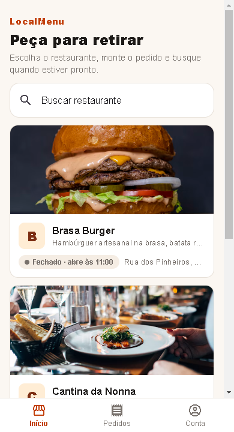
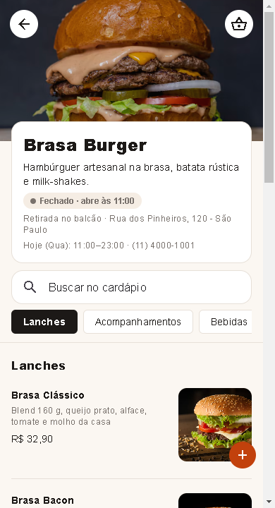
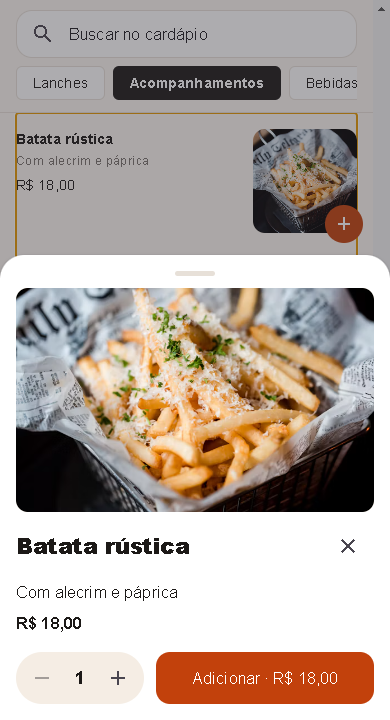
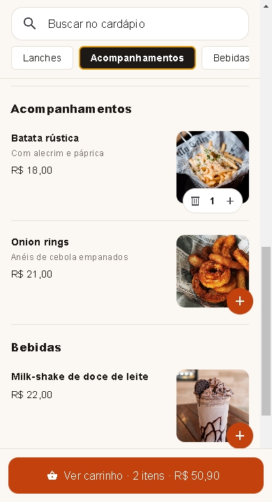
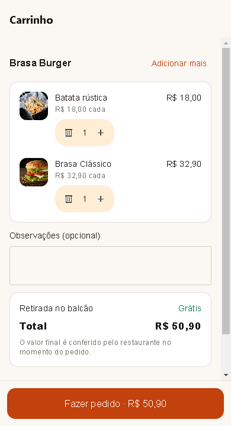
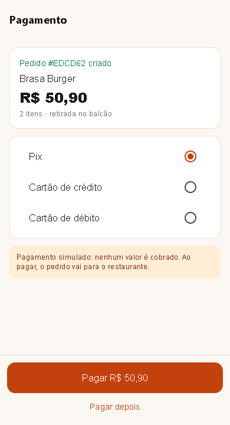
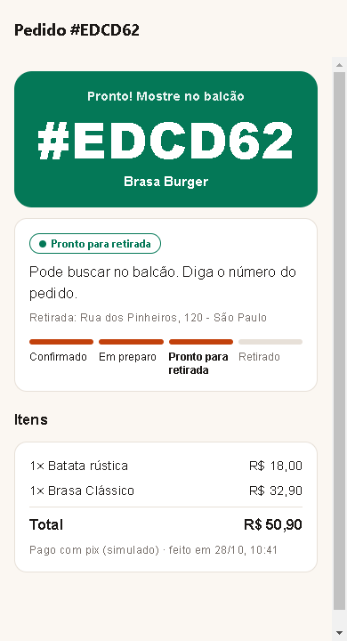
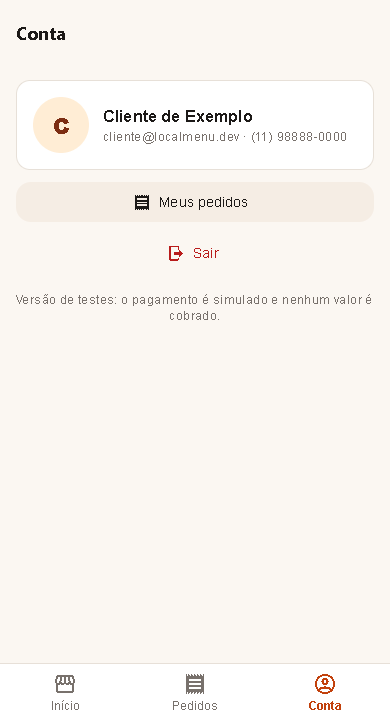

# LocalMenu B2C

App do cliente do LocalMenu, em React Native (Expo) e TypeScript. O cliente escolhe um restaurante, monta o pedido para retirada, paga (pagamento simulado) e acompanha o status até buscar no balcão. Roda 100% local, ligado ao [localmenu_backend](https://github.com/lucax011/localmenu_backend).

Feito para o celular e instalável como app (PWA). Capturas em 390 × 844, o tamanho de um iPhone comum:

| Restaurantes                                    | Cardápio                                | Detalhe do prato                                        | Categorias fixas                                     |
| ----------------------------------------------- | --------------------------------------- | ------------------------------------------------------- | ---------------------------------------------------- |
|  |  |  |  |

| Carrinho                                | Pagamento                                 | Pedido pronto                                       | Conta                             |
| --------------------------------------- | ----------------------------------------- | --------------------------------------------------- | --------------------------------- |
|  |  |  |  |

## Ecossistema LocalMenu

| Repositório                                                                | Papel                                    |
| -------------------------------------------------------------------------- | ---------------------------------------- |
| [localmenu_backend](https://github.com/lucax011/localmenu_backend)         | API NestJS + PostgreSQL                  |
| [localmenu_frontendB2C](https://github.com/lucax011/localmenu_frontendB2C) | App do cliente (Expo)                    |
| [localmenu_frontendB2B](https://github.com/lucax011/localmenu_frontendB2B) | App do restaurante (Expo)                |
| [localmenu_OCRservice](https://github.com/lucax011/localmenu_OCRservice)   | Microsserviço de OCR em Python (FastAPI) |

## O que o cliente faz

1. Vê a lista de restaurantes, sem precisar de conta, e busca por nome ou endereço.
2. Abre o cardápio (`/r/<slug>`, o link do QR code). Vê a capa, se o restaurante está aberto agora e as categorias numa faixa fixa que acompanha a rolagem. A busca ignora acentos.
3. Toca no prato para ver foto grande, descrição e quantidade, ou adiciona direto pelo "+" sobre a foto.
4. Monta o carrinho. Um pedido é de um restaurante só; ao trocar de restaurante o app pergunta antes de esvaziar.
5. Entra ou cria a conta, só na hora de pagar. O carrinho fica guardado enquanto isso.
6. Faz o pedido e paga com Pix ou cartão. O pagamento é simulado: nada é cobrado, e a API confirma o pedido.
7. Acompanha o pedido: o número aparece grande para mostrar no balcão e fica verde quando está pronto. A tela atualiza sozinha a cada 5 segundos.

## Design no celular

- Ações principais na metade de baixo da tela: barra de abas (Início, Pedidos, Conta) e botão principal fixo embaixo.
- Toque mínimo de 44 px, fonte de 16 px nos campos (o iPhone não dá zoom), respeito ao notch.
- Esqueletos cinza no lugar de spinners enquanto carrega.
- Prato sem foto continua bonito: o layout só reserva espaço para a foto quando ela existe.

## PWA

- `public/manifest.webmanifest`: nome, cores e ícones (incluindo maskable) para instalar na tela inicial.
- `public/sw.js`: guarda a casca do app e os bundles; o cardápio vem da rede e, sem rede, da última versão guardada. Pedidos e pagamento nunca passam pelo cache.
- O service worker só é registrado no build de produção (`npm run build:web`), para não guardar bundles velhos durante o desenvolvimento.
- O convite para instalar aparece depois do primeiro pedido e na tela Conta. No iPhone, o app explica o caminho por Compartilhar > Adicionar à Tela de Início.

O preço nunca sai do app: o pedido leva só os itens e as quantidades, e a API calcula o total pelo cardápio.

## Stack

- Expo SDK 51 (React Native 0.74, web pelo Metro)
- React Navigation (stack, com endereços próprios na web)
- React Query para dados da API, Zustand para sessão e carrinho (guardados no aparelho)
- React Native Paper, react-hook-form + zod
- Jest, Cypress (e2e contra a API local), ESLint, Prettier, Husky + lint-staged

Mesma base do app do restaurante ([localmenu_frontendB2B](https://github.com/lucax011/localmenu_frontendB2B)).

## Como rodar

Pré-requisito: a API rodando em `http://localhost:3000`. O README do [localmenu_backend](https://github.com/lucax011/localmenu_backend#subir-tudo-api-ocr-e-os-dois-apps) tem o passo a passo para subir tudo.

```sh
npm install
npm run web        # abre em http://localhost:8082
```

O servidor de desenvolvimento fica preso a `127.0.0.1`: o `scripts/somente-localhost.cjs` impede que o Expo abra a porta para a rede. Para testar num celular pelo Expo Go, rode `npx expo start` direto, sabendo que a porta fica visível na rede local.

A porta 8082 já está liberada no CORS da API (`CORS_ORIGINS` no `.env` do backend). Para apontar para outra API, copie `.env.example` para `.env` e ajuste `EXPO_PUBLIC_API_BASE_URL`.

Conta de exemplo: `cliente@localmenu.dev` / `localmenu123`. Também dá para criar uma conta nova pelo app.

## Scripts

| Comando             | O que faz                                                                        |
| ------------------- | -------------------------------------------------------------------------------- |
| `npm run web`       | Expo Web na porta 8082, só em 127.0.0.1                                          |
| `npm test`          | Testes unitários (carrinho, busca, horários, etapas do pedido)                   |
| `npm run e2e`       | Cypress contra a API local: a jornada inteira, da vitrine ao pedido pronto       |
| `npm run typecheck` | Checagem de tipos                                                                |
| `npm run lint`      | ESLint + Prettier                                                                |
| `npm run build:web` | Gera o PWA estático em `dist/` (com manifest e service worker)                   |
| `npm run capturas`  | Refaz as capturas do README em `docs/capturas` (precisa da API e do app rodando) |

O e2e precisa da API e do app rodando. Ele cria uma conta e um pedido novos a cada execução.

## Estrutura

```
App.tsx                 navegação e endereços da web
src/
  api/                  cliente da API (token com renovação automática) e tipos
  store/                sessão e carrinho
  features/
    restaurants/        lista, cardápio e detalhe do prato
    cart/               carrinho
    auth/               entrar, criar conta e tela Conta
    orders/             pagamento, meus pedidos e acompanhamento
  components/           peças visuais comuns e convite de instalação
  pwa.ts                registro do service worker e instalação
  utils/                carrinho, formatos e validação
  __tests__/            testes unitários
public/                 index.html, manifest, service worker e ícones do PWA
cypress/e2e/            teste ponta a ponta
cypress/capturas/       roteiro das capturas do README
```

## Licença

MIT. Veja [LICENSE](LICENSE).
